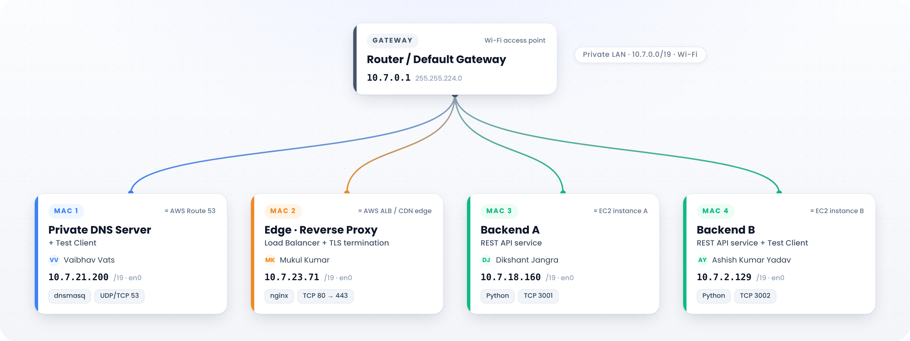
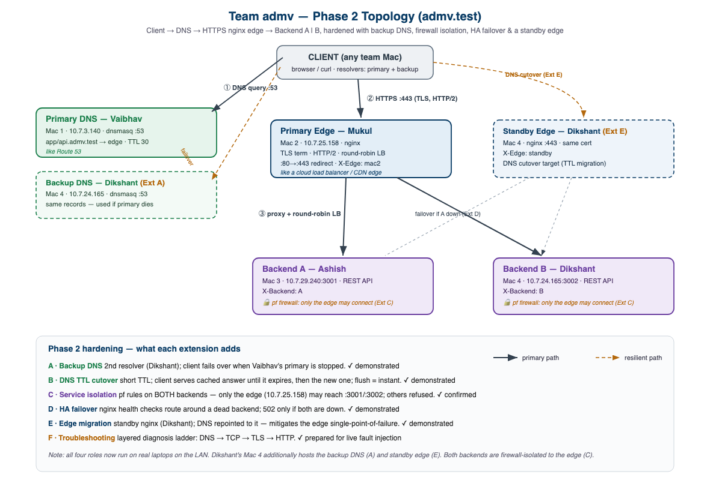
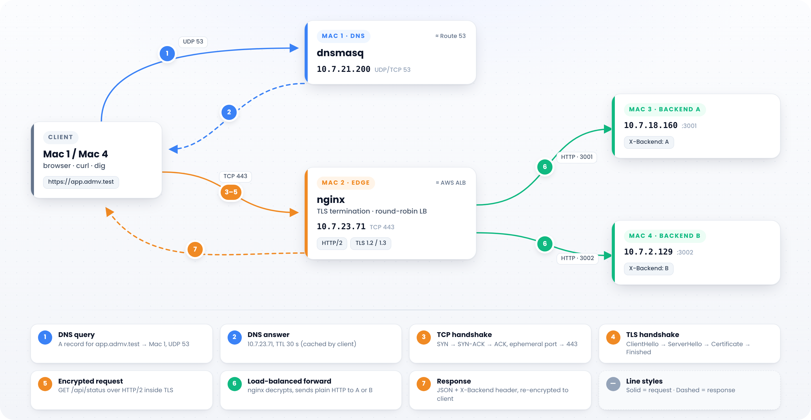

# Architecture Document — Team admv

**Private Network Service Platform** · Phase 1 (Build & Observe) + Phase 2 (Harden & Recover)

Four macOS laptops share one private LAN (`10.7.0.0/19`, gateway `10.7.0.1`).
Clients reach the service only by the name `app.admv.test`, which our own DNS
server resolves to the nginx edge. The edge terminates TLS and load-balances
across two REST backends. Phase 2 adds a backup resolver, firewall isolation,
automatic backend failover and a standby edge.

---

## 1. Topology

### Phase 1

### Phase 2 (hardened)

---

## 2. Machine inventory

Addresses below are from the **Phase 2 session of 24 Nov 2026**, the most recent
verified run (see `evidence/phase2/final-system-verification.txt`, 12/12 PASS).

| Machine | Member | Role | IPv4 | Prefix / Mask | Gateway | Interface | MAC address |
|---|---|---|---|---|---|---|---|
| Mac 1 | Vaibhav Vats | Private DNS server + test client | `10.7.3.140` | /19 (255.255.224.0) | 10.7.0.1 | en0 | `5e:2a:74:cb:d1:2e` |
| Mac 2 | Mukul Kumar | Edge: reverse proxy + load balancer + TLS | `10.7.25.158` | /19 | 10.7.0.1 | en0 | `9a:36:d5:6e:66:4a` |
| Mac 3 | Ashish Kumar Yadav | Backend A (`:3001`) + test client | `10.7.29.240` | /19 | 10.7.0.1 | en0 | `4a:73:18:71:2f:c8` |
| Mac 4 | Dikshant Jangra | Backend B (`:3002`) + backup DNS + standby edge | `10.7.24.165` | /19 | 10.7.0.1 | en0 | `16:ea:47:1f:74:d8` |

`10.7.0.0/19` spans `10.7.0.0 – 10.7.31.255` (8,190 usable hosts). All four
laptops fall inside it, so they reach each other directly at layer 2 without
routing through the gateway.

### Two things to be ready for in the viva

**The addresses changed between Phase 1 and Phase 2, and that is expected.**
Phase 1 ran on `10.7.21.200 / 10.7.23.71 / 10.7.18.160 / 10.7.2.129`. The lab
Wi-Fi assigns addresses by DHCP per session, so they were reissued. Nothing in
the design breaks, because **the TLS certificate is bound to the name
`app.admv.test`, not to an IP**. That is the whole argument for naming things:
the identity survives the address changing.

**Every MAC address above is locally administered.** Check the second-least-
significant bit of the first octet — `0x5e`, `0x9a`, `0x4a`, `0x16` all have it
set. These are macOS *private Wi-Fi addresses*: the OS randomises its MAC per
network for privacy, so these are not the burned-in hardware addresses. If you
re-run `ifconfig` on a different day you may see different values.

**Backend ownership swapped between phases.** In Phase 1, Dikshant ran Backend A
and Ashish ran Backend B. From Phase 2 onward it is the other way round, as
recorded in the table. The table is authoritative.

---

## 3. Service map

| Machine | Service | Software | Protocol / Port | Listens on | Cloud equivalent |
|---|---|---|---|---|---|
| Mac 1 | Private DNS, authoritative for `admv.test`, forwarder for everything else | dnsmasq | UDP + TCP 53 | `0.0.0.0` | AWS Route 53 |
| Mac 2 | HTTP → HTTPS redirect | nginx | TCP 80 | all interfaces | LB listener |
| Mac 2 | HTTPS edge: TLS termination + round-robin load balancing | nginx | TCP 443 | all interfaces | AWS ALB / CDN edge |
| Mac 3 | REST backend A (`X-Backend: A`) | Python `http.server` | TCP 3001 | `0.0.0.0` | EC2 instance A |
| Mac 4 | REST backend B (`X-Backend: B`) | Python `http.server` | TCP 3002 | `0.0.0.0` | EC2 instance B |
| Mac 4 | **Backup** DNS resolver (Ext A) | dnsmasq | UDP + TCP 53 | `0.0.0.0` | Route 53 secondary |
| Mac 4 | **Standby** edge (Ext E) | nginx | TCP 443 | all interfaces | standby ALB |

### DNS records

| Name | Type | Value | TTL |
|---|---|---|---|
| `app.admv.test` | A | `10.7.25.158` | 30 s |
| `api.admv.test` | A | `10.7.25.158` | 30 s |

Both names point at the **edge**, never at a backend. A client that could reach
a backend directly would bypass TLS and load balancing entirely — which is what
Extension C's firewall rules exist to prevent.

---

## 4. Request flow

| # | Step | From → To | Protocol | Port |
|---|---|---|---|---|
| 1 | DNS query for `app.admv.test` | Client → Mac 1 | DNS over UDP | ephemeral → 53 |
| 2 | DNS answer `10.7.25.158`, TTL 30 s | Mac 1 → Client | DNS over UDP | 53 → ephemeral |
| 3 | TCP three-way handshake (SYN, SYN-ACK, ACK) | Client → Mac 2 | TCP | ephemeral → 443 |
| 4 | TLS handshake; certificate for `app.admv.test` signed by admv Local CA | Client ↔ Mac 2 | TLS 1.2 / 1.3 | 443 |
| 5 | `GET /api/status`, encrypted | Client → Mac 2 | HTTP/2 inside TLS | 443 |
| 6 | Request forwarded (round-robin), decrypted | Mac 2 → Mac 3 or Mac 4 | HTTP over TCP | ephemeral → 3001 / 3002 |
| 7 | Response with `X-Backend`, re-encrypted to the client | Mac 2 → Client | HTTP/2 inside TLS | 443 |

The client never learns the backend IPs: they exist only inside the nginx
`upstream` block on Mac 2.

---

## 5. Protocol-to-layer mapping

| Protocol / event | TCP/IP model | OSI layer | Seen in Wireshark as |
|---|---|---|---|
| DNS | Application | 7 | `dns` |
| HTTP/1.1, HTTP/2 | Application | 7 | encrypted client-side; `http` on edge → backend |
| TLS | between Application and Transport | 5–6 | `tls.handshake`, Application Data |
| TCP | Transport | 4 | `tcp.flags.syn == 1`, seq/ack numbers |
| UDP | Transport | 4 | `udp.port == 53` |
| IPv4 | Internet | 3 | source / destination IP |
| Wi-Fi (802.11), MAC addresses | Link | 1–2 | source / destination MAC |

---

## 6. Phase 2 — what was added

The Phase 1 shape is unchanged. Phase 2 layers resilience on top of it.

| Ext | Addition | Where it runs | Failure it survives |
|---|---|---|---|
| A | Backup DNS resolver | Mac 4 (`10.7.24.165`) | primary DNS dies — names still resolve |
| B | Short TTL + controlled record change | Mac 1 | — (demonstrates cutover timing) |
| C | `pf` rules: backend ports accept the edges only | Mac 3, Mac 4 | a client bypassing the edge |
| D | nginx passive health checks | Mac 2 | one backend dies — no client-visible error |
| E | Standby edge + DNS cutover | Mac 4 | the edge itself dies |
| F | Layered diagnosis method | — | an injected fault |

### Remaining single point of failure

With Extension D, either backend can die unnoticed. The **edge** cannot: if Mac 2
stops, everything stops, because DNS sends every client there. Extension E
mitigates this with a standby edge and a DNS cutover, but the mitigation is
*manual and TTL-bounded* — someone has to change the record, and cached clients
keep using the dead edge until their TTL expires. Eliminating it properly would
need either a shared virtual IP with automatic failover (VRRP/`keepalived`) or
two always-live edges behind round-robin DNS with health-checked records.

### A dependency worth stating out loud

Extensions C and E interact. The firewall rules on the backends whitelist
**both** edge addresses — the primary (`10.7.25.158`) and the standby
(`10.7.24.165`). Whitelisting only the primary would mean that the moment an
Extension E cutover happened, the standby could not reach the backends and every
request would return 502. Extension C would have silently broken Extension E.
See `config/pf-backend-a.anchor`.
